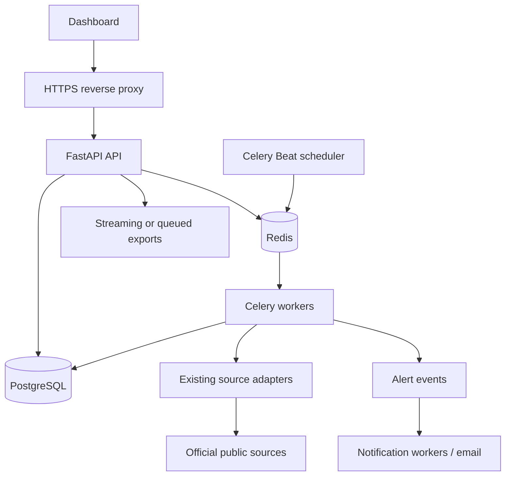

# Production architecture

## Current architecture (Phase 1 baseline)

The application is a single FastAPI service serving the Arabic dashboard from `app/static` and the JSON/export API from the same process. SQLAlchemy connects to SQLite by default for local development and accepts PostgreSQL through `DATABASE_URL`. Alembic owns schema changes, although the existing container entrypoint currently runs migrations before starting the API.

Background ingestion runs in the API process. `scheduler_loop` polls enabled sources every minute and calls `sync_source`; an `asyncio.Lock` prevents overlap only inside one Python process. Each adapter fetches official public data with HTTPX, then the service normalizes and persists source records, immutable observations, source opportunities, master opportunities, conflicts, review items, provenance, and change history. Sync job rows and source errors provide basic execution history.

The dashboard reads the API directly. Admin operations use one shared `ADMIN_TOKEN`; the `users` table exists but is not used for sign-in or authorization. Exports are generated synchronously from the API. Health is represented by `/api/health`; there is no separate readiness check, metrics endpoint, queue, worker service, or notification delivery service.

| Area | Current implementation |
| --- | --- |
| Frontend | Static Arabic RTL HTML/CSS/JavaScript in `app/static` (not Next.js) |
| Backend | FastAPI in `app/main.py` |
| Database | SQLAlchemy; SQLite local default, PostgreSQL URL supported |
| Background jobs | `sync_source` called in API process |
| Scheduler | In-process polling loop |
| Source adapters | Ten adapters in `app/adapters.py` |
| Raw observations | `SourceObservation`, plus raw JSON on source rows |
| Source opportunities | `SourceOpportunity` and dataset memberships |
| Master opportunities | `Opportunity`, with provenance and merge history |
| Review queues | Duplicate, location, qualification, and conflict tables |
| Exports | Synchronous CSV and XLSX API endpoints |
| Admin interface | Dashboard UI and token-protected API routes |

## Target production architecture

Production separates request serving, scheduling, and sync execution. FastAPI remains the API and static dashboard host. PostgreSQL is the sole production database. Redis carries queued work and distributed source locks. Celery workers execute one source sync task at a time per source; Celery Beat (one active scheduler, protected by a Redis lease) dispatches configurable schedules. The source adapter and normalization pipeline remain unchanged behind the worker boundary.

The API owns authentication, authorization, audit records, operational controls, health/readiness, metrics, and administrative views. PostgreSQL persists job state, users, audit events, alerts, and ingestion data. Redis is an ephemeral queue/lock dependency, not the system of record. Workers report heartbeats and transition persisted jobs; stale-job recovery can requeue work safely because the ingestion pipeline remains idempotent. Source schedules and enablement are configuration data rather than worker code.

## Deployment boundary

The production reference is containerized API, worker, and scheduler services behind an HTTPS proxy, with private PostgreSQL and Redis services or managed equivalents. TLS terminates at a cloud load balancer with managed certificates or at Nginx/Traefik with automated ACME renewal; the edge redirects HTTP to HTTPS. Certificate keys remain in the proxy/secret store. The proxy forwards `X-Forwarded-For` and `X-Forwarded-Proto` only over the private service network. Staging uses distinct database, Redis, and secrets. Migrations run as a deployment step and halt rollout on failure. The local Compose file is a reference environment, not a substitute for managed backups, secret storage, TLS termination, alert delivery, or infrastructure monitoring.

## Production guarantees and limits

The ten public-source adapters and their current classification rules are retained. Public coverage limitations remain data, not source failures. A source's external health is separate from API readiness. Production readiness requires validating the complete service topology, tested backup restoration, delivery configuration, and deployment controls in the actual target environment; local code checks alone cannot establish those operational facts.

Retention and database-growth policy is defined in [data retention and growth](data-retention.md). Application metrics do not automatically prune source or Master history.
