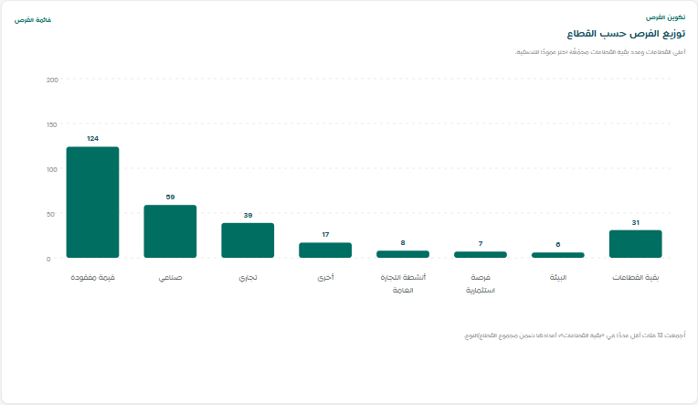
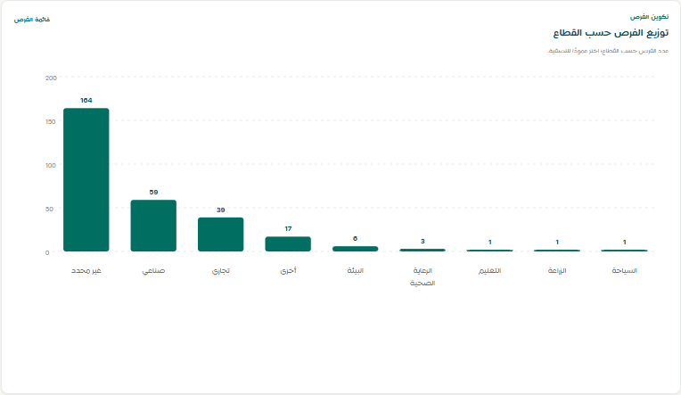

# Sector taxonomy deep review

**Run date:** 2026-10-18  
**Scope:** existing Al-Ahsa opportunity platform, 291 non-merged Master Opportunities and 2,898 linked SourceOpportunity records.  
**Backfill gate:** dry-run inspected and saved before apply. No source sync ran.

## Outcome

The business-facing Sector dimension now uses the canonical sector IDs from `app/standardization.py`. Sector, Activity, and Opportunity Type are separate fields. The local backfill changed 290 Master records across 476 field values; it did not merge/split Masters or change source rows, raw payloads, references, or source links. Forty records were placed in the taxonomy review queue. Uncertain sector values were set to `غير محدد`, not guessed into a sector.

## Master Sector values before the backfill

There were 20 distinct stored values across 291 non-merged Masters. The chart-only labels `قيمة مفقودة` and `بقية القطاعات` were not stored Master values: the former represented null Sector values, and the latter was a chart remainder bucket. Their chart counts were 124 and 31, respectively.

| Stored value before | Count | Treatment | Canonical Sector after |
|---|---:|---|---|
| `<NULL>` | 124 | Missing | غير محدد |
| `COMMERCIAL_FACILITY_OPPORTUNITY` | 1 | Wrong dimension; retain opportunity type, review | غير محدد |
| `LEASE_OPPORTUNITY` | 2 | Wrong dimension; retain opportunity type, review | غير محدد |
| `PPP_PROJECT` | 1 | Wrong dimension; retain opportunity type, review | غير محدد |
| أخرى | 17 | Keep canonical | أخرى |
| أنشطة التجارة العامة | 8 | Move explicit activity wording to Activity; review sector | غير محدد |
| أنشطة تجارة المواد الغذائية | 5 | Move explicit activity wording to Activity; review sector | غير محدد |
| أنشطة وخدمات انتاج المواد غير الغذائية | 1 | Move activity wording to Activity; review sector | غير محدد |
| البيئة | 6 | Keep canonical | البيئة |
| الساحات الميادين | 1 | Move activity wording to Activity; review sector | غير محدد |
| العربات المتنقلة | 2 | Move activity wording to Activity; review sector | غير محدد |
| المباني | 1 | Move activity wording to Activity; review sector | غير محدد |
| تجاري | 39 | Keep canonical | تجاري |
| خدمات الصرافة | 6 | Move activity wording to Activity; review sector | غير محدد |
| خدمات تعليمية أخرى | 1 | Move activity wording to Activity; review sector | غير محدد |
| خدمي | 5 | Move ambiguous service classification to Activity; review sector | غير محدد |
| صناعي | 59 | Keep canonical | صناعي |
| فرصة استثمارية | 7 | Evidence review by record (below) | عدة قطاعات / غير محدد |
| محلات تجارية | 3 | Move activity wording to Activity; review sector | غير محدد |
| منشآت تقديم الغذاء | 2 | Move activity wording to Activity; review sector | غير محدد |
| **Total** | **291** |  | **291** |

There was no stored Master row with the literal value `قيمة مفقودة` or `بقية القطاعات`; they are still covered by the standardization/filter aliases. No stored Master row used `بقية القطاعات` as Sector, so the actual pre-backfill count for that raw alias was zero. The historic chart's 31 was its synthetic “remainder” count, not 31 records classified with that value. The source census likewise found no literal `بقية القطاعات` in `source_sector`.

## Canonical taxonomy and reconciled counts

Each ID is stable and business-facing labels are Arabic. Categories without a current Master record remain available to the engine for future approved mappings; their current count is zero.

| Canonical ID | Arabic label | Master count after |
|---|---|---:|
| `sector:unspecified` | غير محدد | 164 |
| `sector:industrial` | صناعي | 59 |
| `sector:commercial` | تجاري | 39 |
| `sector:other` | أخرى | 17 |
| `sector:environment` | البيئة | 6 |
| `sector:healthcare` | الرعاية الصحية | 3 |
| `sector:education` | التعليم | 1 |
| `sector:agriculture` | الزراعة | 1 |
| `sector:tourism` | السياحة | 1 |
| `sector:logistics` | الخدمات اللوجستية | 0 |
| `sector:real_estate` | العقارات والإنشاءات | 0 |
| `sector:energy` | الطاقة | 0 |
| `sector:culture` | الثقافة | 0 |
| `sector:sports` | الرياضة | 0 |
| `sector:financial_services` | الخدمات المالية | 0 |
| `sector:technology` | التقنية والاتصالات | 0 |
| **Total** |  | **291** |

`أخرى` and `غير محدد` remain distinct. Approved aliases including `اخرى`, `أخري`, `غير ذلك`, `Other`, `Others`, and `بقية القطاعات` resolve to `sector:other` / `أخرى`. Null, blank, `قيمة مفقودة`, and `غير مصنف` resolve to `sector:unspecified` / `غير محدد`. Generic opportunity-type enums—including `فرصة استثمارية`, `INVESTMENT_OPPORTUNITY`, `LEASE_OPPORTUNITY`, and `PPP_PROJECT`—cannot resolve to a valid sector.

The before/after reconciliation uses the same 291 non-merged Master population. The after categories come from `/api/data-dashboard`; the sector chart sum and total are both 291. Selecting `أخرى` returns 17 records; selecting `غير محدد` returns 164.

The 290-versus-291 report discrepancy was reconciled against PostgreSQL at a fixed 2026-10-18 timestamp. `master_count=291`; `records_affected=290` means 290 records changed and one (Master 21) was already canonical. The read-only API and row-level evidence are documented in [the sector count reconciliation](sector-count-reconciliation-2026-10-18.md) and [its 291-row dataset](sector-count-reconciliation-2026-10-18.csv).

## Record-level review of `فرصة استثمارية`

All seven rows had the generic source category `INVESTMENT_OPPORTUNITY`, which is Opportunity Type evidence, not a Sector. Six were assigned to a sector from specific official opportunity descriptions; one has no defensible sector evidence and remains `غير محدد` with review required.

| Master ID | Opportunity | Proposed Sector | Evidence / status |
|---:|---|---|---|
| 211 | الخدمات الرقمية للإرشاد والتوجيه المهني | غير محدد | Description is not enough to determine an economic sector; review required |
| 212 | تطوير فنادق 5 نجوم في المنطقة الشرقية | السياحة | Official description specifies a five-star hotel/resort; confirmed |
| 213 | مستشفيات الأمومة والأطفال | الرعاية الصحية | Hospital project; confirmed |
| 214 | الخدمات الطبية للمدارس | الرعاية الصحية | Medical services; confirmed |
| 215 | المعالجة الأولية للتمور | الزراعة | Date processing/agricultural production facility; confirmed |
| 216 | تطوير مراكز الرعاية الصحية الأولية | الرعاية الصحية | Primary healthcare facilities; confirmed |
| 217 | مراكز التدريب التقني والمهني في السياحة والضيافة | التعليم | Technical/professional training centers; confirmed |

The complete JSON contains owner, sources, raw source Sector/Subsector, Activity, category, opportunity type, evidence, action, and status for every record: [`dry-run-report.json`](dry-run-report.json). A concise CSV is also available: [`investment-opportunity-reclassification.csv`](investment-opportunity-reclassification.csv).

## Source and taxonomy candidate census

The source-side census covered all 2,898 SourceOpportunity records: 2,774 had a nonempty raw `source_sector`, 124 did not, and there were 133 distinct nonempty raw Sector strings. The report does not modify these source rows. Distinct-value classifications are:

| Candidate classification | Distinct raw values | Source records |
|---|---:|---:|
| Approved exact aliases/source labels mapped by the shared engine or adapter | 25 | 1,843 |
| Exact canonical labels/IDs | 3 | 118 |
| Possible Activity or sub-activity | 11 | 35 |
| Unmapped Arabic values for review | 2 | 2 |
| Unmapped English/source labels for review | 86 | 713 |
| Wrong-dimension Opportunity Type/category values | 6 | 63 |
| Missing raw Sector | — | 124 |
| **Total source records** | **133 distinct populated values** | **2,898** |

Examples of wrong-dimension values include `INVESTMENT_OPPORTUNITY`, `PPP_PROJECT`, `LEASE_OPPORTUNITY`, and `COMMERCIAL_FACILITY_OPPORTUNITY`. Potential Activity values include `أنشطة التجارة العامة`, `أنشطة تجارة المواد الغذائية`, `خدمات الصرافة`, `منشآت تقديم الغذاء`, and `العربات المتنقلة`. Exact source labels already approved by the adapter, such as `Petrochemical and Convention industries`, `Real Estate & Construction`, `Machinery and Equipment`, `Recycling`, and `Transport and Logistics`, map through those reviewed complete-label rules. Other labels such as `Administrative Real Estate`, `Adventure Tourism`, `Automotive`, and `Building Materials` remain source evidence and review candidates; the engine does not infer sectors from keyword matches. Full 133-value census: [`source-sector-taxonomy-candidates.csv`](source-sector-taxonomy-candidates.csv) and [`source-sector-taxonomy-candidates.json`](source-sector-taxonomy-candidates.json). The complete cross-dimension source field audit remains in [`standardized-source-values.csv`](standardized-source-values.csv), [`source-value-audit-summary.json`](source-value-audit-summary.json), and [`deep-source-sector-audit.json`](deep-source-sector-audit.json).

Forty Master records are review-needed: 33 Sector values were moved into Activity with Sector left `غير محدد`; four enum/type values were moved out of Sector and retained as Opportunity Type; two unmapped labels were preserved as Activity with Sector `غير محدد`; and Master 211 remains `غير محدد` after the individual evidence review. These are visible in [`master-sector-before-after.csv`](master-sector-before-after.csv) and were recorded as open taxonomy conflicts where source linkage exists.

## Applied change and safety verification

- Dry-run reported 291 Masters, 290 affected records, and 40 review-needed records before any data write.
- Backfill applied **476 field changes** across those 290 Master records. It adds `ChangeHistory` entries and open taxonomy conflicts for the review cases.
- Migration `0018_sector_activity` adds nullable Master `activity` and source `source_activity` fields. It does not rewrite source records.
- Master IDs/canonical IDs digest is identical before/after the backfill. Source record count (2,898), source IDs/master links, raw Sector/Activity fields, and raw JSON payload digest are identical before/after. See [`source-integrity-before.json`](source-integrity-before.json) and [`source-integrity-after.json`](source-integrity-after.json).
- No Master merge/split or matching rule changed. No source synchronization ran.
- Existing SourceOpportunity raw and standardized snapshots were left untouched to preserve provenance; future ingestion writes standardization version 6, with Sector, Activity, and Opportunity Type kept separate. Version 6 also strips decorative quote pairs before taxonomy identity lookup while preserving the original raw value.

## Verification

- Full API/backend suite: **125 passed**, 1 upstream Starlette/httpx deprecation warning.
- Live API verification (`scripts/verify_sector_taxonomy_exports.py`): canonical filter options, 291-count dashboard reconciliation, 17-row `أخرى` filter, opportunity detail, CSV headers/values, and XLSX headers/values all passed.
- Browser verification at 1920×1080: RTL is preserved; sector dropdown has only canonical business labels; `أخرى` returns 17 rows; search and pagination work; reset returns to all 291 records; detail view separates Sector and Activity; CSV returns 17 canonical rows; XLSX returns a valid workbook; no horizontal overflow.
- Dashboard chart shows nine data-backed canonical categories and no `قيمة مفقودة`, `بقية القطاعات`, or `فرصة استثمارية` category. `scripts/capture_sector_taxonomy_chart.cjs` captured the chart at a 1920×1080 viewport.

| Before | After |
|---|---|
|  |  |

## Files changed

Application: `app/standardization.py`, `app/filter_canonicalization.py`, `app/models.py`, `app/adapters.py`, `app/service.py`, `app/main.py`, `app/excel_export.py`, `app/static/index.html`, `app/static/app.js`, `app/static/data-dashboard.js`, `app/static/styles.css`.

Schema and design: `migrations/versions/0018_sector_activity.py`, `docs/design/data-standardization-engine.md`.

Tests: `tests/test_standardization_engine.py`, `tests/test_filter_canonicalization.py`, `tests/test_data_dashboard.py`, `tests/test_wave2_adapters.py`, `tests/test_excel_presentation.py`, `tests/test_ingestion.py`, `tests/test_opportunities_search_count.py`.

Audit/verification artifacts and scripts are in this directory and under `scripts/`: dry-run/reclassification reports, raw-value census, integrity snapshots, API export checks, browser checks, and before/after screenshots.
